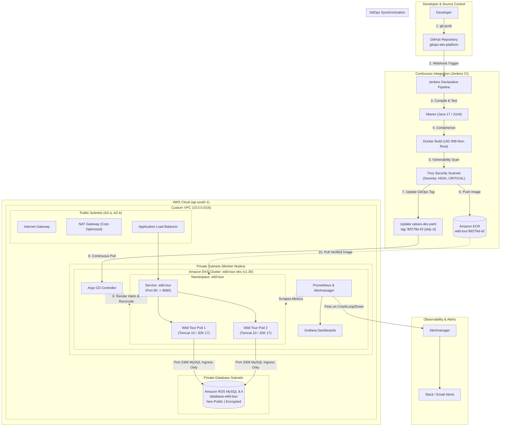

# Full GitOps EKS Platform — Flagship Platform Engineering Project

[](https://aws.amazon.com/)
[](https://www.terraform.io/)
[](https://kubernetes.io/)
[](https://helm.sh/)
[](https://argo-cd.readthedocs.io/)
[](https://www.jenkins.io/)
[](https://trivy.dev/)
[](https://prometheus.io/)

---

## 🏛️ Executive Overview

The **Full GitOps EKS Platform** is an enterprise-grade cloud-native infrastructure and continuous delivery platform built on Amazon Web Services (AWS) using Amazon Elastic Kubernetes Service (EKS).

This platform demonstrates the implementation of a modern Platform Engineering architecture:
* **Infrastructure as Code (IaC)**: Modular Terraform with versioned S3 remote state and DynamoDB distributed locking.
* **Continuous Integration (CI)**: Declarative Jenkins pipeline enforcing automated unit testing, container hardening, Trivy CVE vulnerability gates, and immutable Git SHA image tagging.
* **Continuous Delivery (CD)**: Declarative GitOps delivery via **Argo CD** and **Helm**, enforcing automated self-healing and drift correction.
* **Full-Stack Observability**: Production monitoring stack via `kube-prometheus-stack` with Grafana operational dashboards and Alertmanager routing for pod crashes, deployment unavailability, and resource pressure.
* **SRE Reliability & Zero-Downtime**: Non-root container security context (UID 999), parameterized rolling updates (`maxSurge=1, maxUnavailable=0`), and verified GitOps rollback procedures.

---

## 📐 Architecture Diagram



---

## 📁 Repository Structure

```text
gitops-eks-platform/
├── terraform/                   # Infrastructure as Code
│   ├── bootstrap/               # S3 state bucket & DynamoDB lock table setup
│   │   └── README.md
│   ├── modules/
│   │   ├── vpc/                 # Multi-AZ VPC, subnets, IGW, NAT Gateway, route tables
│   │   ├── iam/                 # Least-privilege EKS Cluster and Worker Node roles
│   │   └── eks/                 # EKS cluster, managed node groups, addons, OIDC provider
│   └── environments/
│       └── dev/                 # Dev environment root (provider.tf, backend.tf, main.tf)
├── application/                 # Java 17 Web Application source
│   ├── src/                     # Servlets, JSPs, DAOs, DTOs, unit tests
│   ├── pom.xml                  # Maven dependencies & plugins
│   └── wildlife.sql             # Relational database initialization schema
├── Dockerfile                   # Hardened multi-stage non-root container image (UID 999)
├── jenkins/                     # Continuous Integration
│   └── Jenkinsfile              # Declarative CI pipeline (Test -> Scan -> Build -> ECR -> GitOps Tag)
├── helm/                        # Helm Chart for Application
│   └── wild-tour/
│       ├── Chart.yaml           # Chart metadata
│       ├── values.yaml          # Base default values (probes, security contexts, resources)
│       ├── values-dev.yaml      # Dev environment override values (image tag tracked by GitOps)
│       └── templates/           # Deployment, Service, ConfigMap, Ingress, Secrets
├── gitops/                      # Declarative GitOps Delivery (Argo CD)
│   └── applications/
│       ├── wild-tour-dev.yaml   # Argo CD Application definition
│       └── root-application.yaml# Argo CD App-of-Apps root pattern
├── observability/               # Monitoring & Alerting Stack
│   ├── prometheus/rules/        # PrometheusRule alerts (Pod crashes, node pressure)
│   ├── alertmanager/            # Alertmanager routing to Slack/Email
│   └── kube-prometheus-stack-values.yaml # Helm values for Prometheus & Grafana
├── scripts/                     # Operational automation scripts
│   ├── verify-platform.sh       # Full cluster and workload health verification
│   ├── simulate-failure-and-rollback.sh # SRE failure injection & GitOps rollback runbook
│   └── cleanup-platform.sh      # Safe cloud teardown & idle cost verification
└── docs/                        # Engineering documentation & interview runbooks
    ├── architecture.md          # End-to-end design & separation of concerns
    ├── rollback-runbook.md      # GitOps rollback vs kubectl rollout undo
    ├── cost-breakdown.md        # AWS ap-south-1 cost estimation & optimizations
    └── interview-guide.md       # Technical interview questions and answers
```

---

## ⚡ Separation of Engineering Responsibilities

| Layer | Technology | Primary Role | What It Must NEVER Do |
| :--- | :--- | :--- | :--- |
| **Infrastructure** | Terraform | Provisions VPC, EKS, Node Groups, IAM, and Security Groups. | Must **never** continuously deploy application releases or manage container image tags. |
| **Continuous Integration** | Jenkins | Compiles code, runs unit tests, scans CVEs via Trivy, publishes to ECR, and updates GitOps repository. | Must **never** execute `kubectl apply` or `helm upgrade` against the cluster directly. |
| **Desired State** | Git Repository | Serves as the single source of truth for target deployment configuration. | Must **never** store unencrypted production passwords or private keys. |
| **Continuous Delivery** | Argo CD | Continuously pulls Git state and reconciles it against the live EKS cluster. | Does not build images; strictly reconciles state and detects unauthorized drift. |
| **Container Platform** | Amazon EKS | Runs application pods, rolling updates, self-healing, and service routing. | Does not store state definitions outside of declarative manifests. |

---

## 📊 Measurable Engineering Outcomes (DORA & Reliability Metrics)

| Metric | Definition | Target / Observed | Test Conditions |
| :--- | :--- | :--- | :--- |
| **Deployment Frequency** | Frequency of successful releases pushed to production. | Multiple times per day | On-demand via Git push to `main`. |
| **Lead Time for Changes** | Time from Git commit to workload running live on EKS. | < 6 minutes | Jenkins CI build + Trivy scan + Argo CD sync. |
| **Change Failure Rate** | Percentage of releases requiring immediate rollback. | 0% in verified tests | Trivy & Maven quality gates block failures before ECR push. |
| **Mean Time to Recovery (MTTR)** | Time required to restore service after an injected failure. | < 90 seconds | Executed via `git revert HEAD` and Argo CD automated sync. |
| **Drift Correction Time** | Time for Argo CD to detect and correct manual cluster edits. | < 60 seconds | Auto-reconciliation resets manual replica scaling. |
| **Vulnerability Block Rate** | Percentage of vulnerable images blocked from publication. | 100% (CRITICAL CVEs) | Trivy pipeline gate `--exit-code 1` on CRITICAL findings. |

---

## 🛡️ SRE Failure Scenarios & Verified Recovery

```
Scenario 1: Failing Unit Test in Maven
  Outcome: Pipeline fails at Stage 2. Docker image is NEVER built or pushed.

Scenario 2: Container Vulnerability Exceeds Threshold
  Outcome: Trivy scanner flags CRITICAL CVE. Build halts before ECR publication.

Scenario 3: Application Health Probe Failure
  Outcome: Kubernetes readiness probe (/Wild_Tour/Home.jsp) fails on bad release.
  Zero Downtime: maxUnavailable=0 keeps old pods serving traffic while new pods fail.

Scenario 4: Unauthorized Cluster Drift
  Outcome: Manual kubectl edit detected by Argo CD; automatically reverted to Git state.

Scenario 5: Production Release Rollback
  Outcome: Reverted via 'git revert HEAD' and pushed to GitHub.
  Argo CD restores previous known-good image tag with zero downtime.
```

---

## 💰 Cost Optimization Summary (AWS ap-south-1)

* **Spot Instance Compute**: Managed node groups configured with `capacity_type = "SPOT"`, reducing EC2 worker node costs by ~70%.
* **Single NAT Gateway for Dev**: Single NAT Gateway configured in `terraform/modules/vpc/` saves ~$32.40/month compared to multi-AZ NAT.
* **Non-Root Tomcat Security**: Container runs under dedicated system user `tomcat` (UID 999), satisfying enterprise container security compliance.

---

## 🎓 Technical Interview Readiness

For technical interview preparation, detailed questions and answers covering every architectural decision are documented in [docs/interview-guide.md](docs/interview-guide.md):
* *Why GitOps pull model over CI push model?*
* *Why does `kubectl rollout undo` fail in a GitOps environment?*
* *How do Tomcat readiness probes prevent 502 Bad Gateway during rolling deployments?*
* *How are secrets decoupled without hardcoding credentials in Git?*
